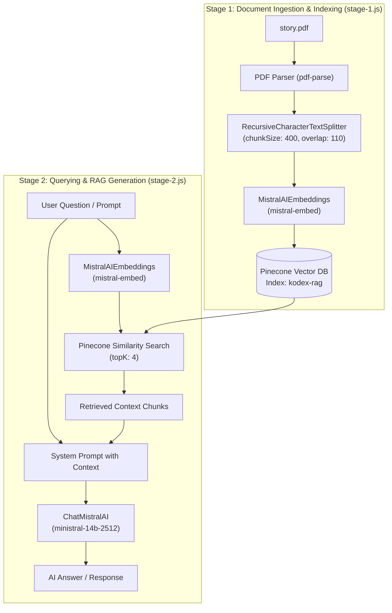

# 📚 Node.js RAG Implementation (Mistral AI + Pinecone)

A lightweight, two-stage **Retrieval-Augmented Generation (RAG)** pipeline built with Node.js, LangChain, Mistral AI, and Pinecone vector database.

This project demonstrates how to extract knowledge from local documents (PDFs), embed and index them in a vector database, and retrieve relevant context to answer user queries with an LLM.

---

## 📌 Architecture & Workflow

The pipeline is split into two modular stages:



---

## 🚀 Features

- **Document Processing**: Parses PDF files locally using `pdf-parse`.
- **Intelligent Chunking**: Splits text into overlapping chunks using LangChain's `RecursiveCharacterTextSplitter` to preserve semantic continuity across boundaries.
- **Dense Vector Embeddings**: Generates 1024-dimensional semantic embeddings using Mistral AI's `mistral-embed` model.
- **Cloud Vector Storage**: Stores vector representations and chunk metadata in Pinecone for ultra-fast vector similarity search.
- **Context-Augmented Answering**: Queries Pinecone for top-$K$ matching documents and grounds Mistral AI's response with retrieved factual context.

---

## 🛠️ Tech Stack

- **Runtime**: Node.js (ES Modules)
- **Framework & Orchestration**: [LangChain](https://js.langchain.com/) (`@langchain/core`, `@langchain/mistralai`, `@langchain/textsplitters`)
- **LLM & Embeddings Provider**: [Mistral AI](https://mistral.ai/) (`mistral-embed`, `ministral-14b-2512`)
- **Vector Database**: [Pinecone](https://www.pinecone.io/) (`@pinecone-database/pinecone`)
- **Document Parser**: `pdf-parse`
- **Environment Management**: `dotenv`

---

## 📂 Project Structure

```text
├── .env                  # Environment secrets (API keys)
├── .env.example          # Sample environment variables template
├── .gitignore            # Git ignore rules
├── package.json          # Node.js dependencies and metadata
├── stage-1.js            # Ingestion script: PDF parsing, chunking, embedding & upserting
├── stage-2.js            # Query script: Query embedding, context retrieval & LLM generation
├── story.pdf             # Sample input PDF document
└── README.md             # Project documentation
```

---

## ⚙️ Prerequisites & Setup

### 1. Prerequisites
- **Node.js** (v18+ recommended)
- **Mistral AI API Key**: Sign up at [Mistral AI Console](https://console.mistral.ai/)
- **Pinecone API Key**: Sign up at [Pinecone Console](https://app.pinecone.io/)

### 2. Set Up Pinecone Index
Before running the scripts, create an index in your Pinecone dashboard:
- **Index Name**: `kodex-rag` *(or update the index name in `stage-1.js` and `stage-2.js`)*
- **Dimensions**: `1024` *(required for Mistral `mistral-embed`)*
- **Metric**: `cosine`

### 3. Installation
Clone the repository and install the dependencies:

```bash
git clone https://github.com/abhiii1120/rag_implementation.git
cd rag_implementation
npm install
```

### 4. Configure Environment Variables
Copy [.env.example](file:///.env.example) to `.env`:

```bash
cp .env.example .env
```

Open `.env` and fill in your API credentials:

```ini
MISTRAL_API_KEY=your_mistral_api_key_here
PINECONE_API_KEY=your_pinecone_api_key_here
```

---

## 📖 Usage Guide

### Stage 1: Ingest & Index Documents
Place your target PDF in the root directory (defaults to `story.pdf`) and run:

```bash
node stage-1.js
```

**What happens:**
1. Loads and extracts text from [story.pdf](file:///story.pdf).
2. Chunks the text into segments of 400 characters with 110-character overlap.
3. Generates vector embeddings for all chunks via Mistral AI.
4. Upserts records (vectors + raw text in metadata) into Pinecone index `kodex-rag`.

---

### Stage 2: Query the RAG Pipeline
Run the query script to ask questions against your indexed documents:

```bash
node stage-2.js
```

**What happens:**
1. Converts the query defined in [stage-2.js](file:///stage-2.js) (`userPrompt`) into an embedding vector.
2. Retrieves the top 4 most semantically relevant text chunks from Pinecone.
3. Injects the retrieved chunks into the LLM system prompt as context.
4. Generates a grounded response using Mistral's `ministral-14b-2512` model and logs the output.

> [!TIP]
> To ask a different question, update the `userPrompt` variable inside [stage-2.js](file:///stage-2.js).

---

## 🔧 Key Configurations

| Parameter | File | Current Value | Description |
| :--- | :--- | :--- | :--- |
| `chunkSize` | [stage-1.js](file:///stage-1.js#L19) | `400` | Max character count per chunk |
| `chunkOverlap` | [stage-1.js](file:///stage-1.js#L20) | `110` | Overlapping characters between adjacent chunks |
| Embedding Model | [stage-1.js](file:///stage-1.js#L30) & [stage-2.js](file:///stage-2.js#L10) | `mistral-embed` | Generates 1024-dim dense vectors |
| Pinecone Index | [stage-1.js](file:///stage-1.js#L40) & [stage-2.js](file:///stage-2.js#L18) | `kodex-rag` | Target vector index name |
| `topK` | [stage-2.js](file:///stage-2.js#L23) | `4` | Number of context chunks retrieved for generation |
| Chat Model | [stage-2.js](file:///stage-2.js#L27) | `ministral-14b-2512` | Mistral chat completion model |

---

## 📜 License

This project is licensed under the ISC License.
